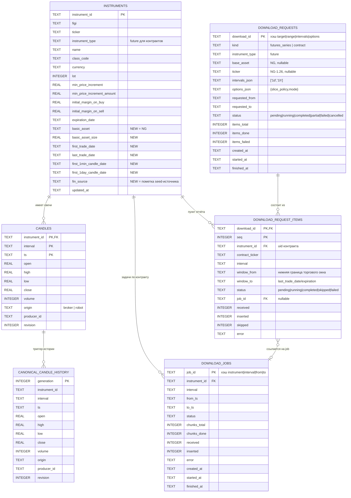
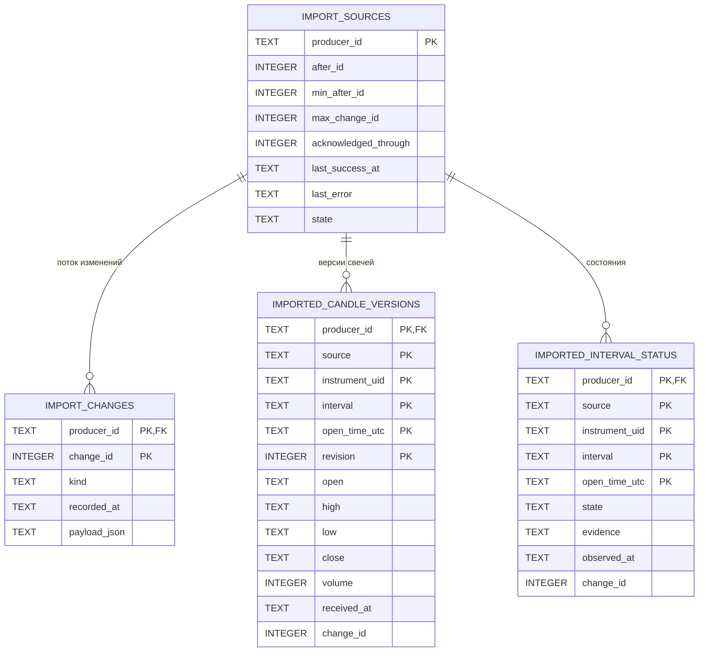
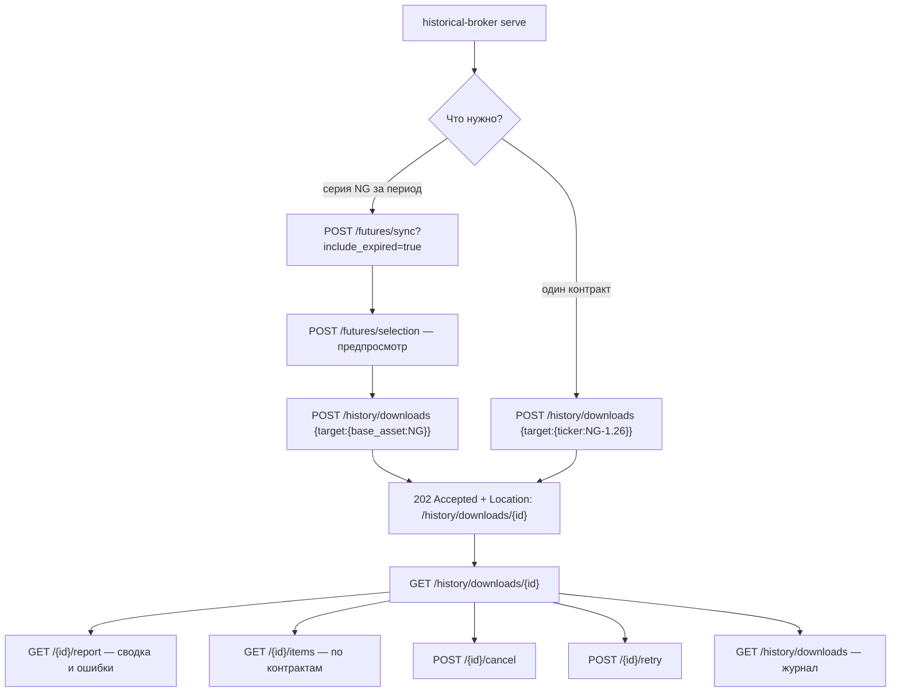
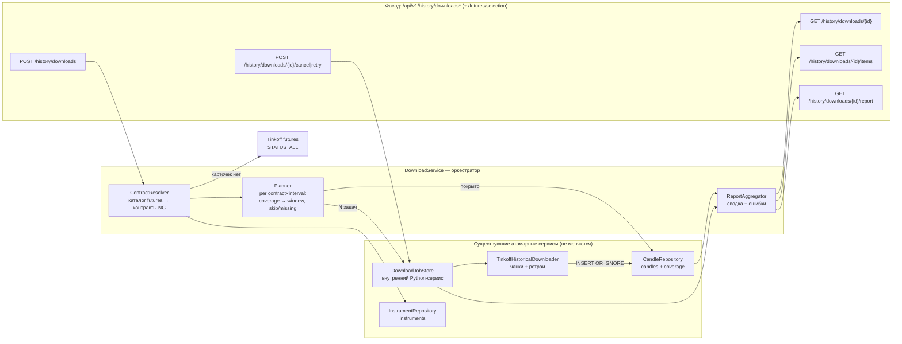
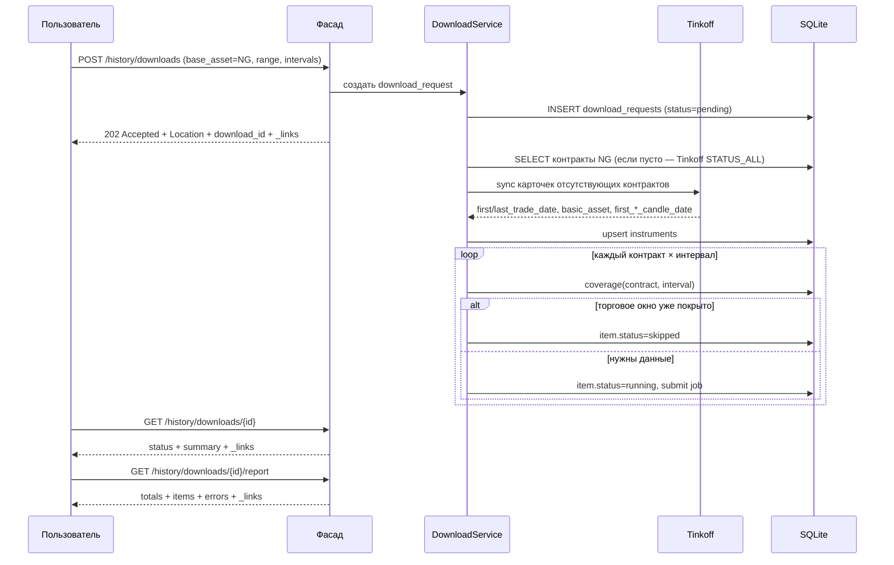

# Загрузка истории акций и фьючерсов одним действием — проектное решение

Статус: **downloads реализован; старые HTTP-эндпоинты download/jobs удалены**.
Документ фиксирует договорённости по
сервису, который загружает свечи акций по тикеру за период, а фьючерсов — по
тикеру или базовому активу. Сервис сам определяет нужные инструменты,
догружает отсутствующее и сохраняет отчёт о прогоне.

Смежные документы: [`market-data-export-integration.md`](market-data-export-integration.md),
[`existing_robot_api_analysis.md`](existing_robot_api_analysis.md), `README.md`.
Главный ресурс чтения:
[`instrument-resource-api-design.md`](instrument-resource-api-design.md).

Замечания к подключённому API:
[`implemented-api-contract-audit.md`](implemented-api-contract-audit.md).
Состав дальнейших доработок:
[`planned-api-change-plan.md`](planned-api-change-plan.md).

Согласована новая публичная модель инструмента по типу и тикеру: карточка,
вложенные свечи и покрытие, батч на коллекции. Сервер реализует её как общую
поверхность чтения; формы в Swagger помечены implemented. Клиент робота
переходит на неё отдельной миграцией.
Разделы 4 и 6 сохраняют исходную модель и диаграммы фьючерсного сценария;
адаптация их к акциям вынесена в состав доработок.

Контракт API: [`openapi.yaml`](openapi.yaml) — полное описание всех эндпоинтов.

> Диаграммы нарисованы в формате Mermaid. В консоли они не рендерятся:
> смотрите файл в VS Code (предпросмотр Markdown с расширением Mermaid) или на
> <https://mermaid.live>.

## 0. Словарь

- **Базовый актив** (`basic_asset`) — то, чем торгует фьючерс, например `NG`
  (природный газ). В Tinkoff это отдельное поле карточки контракта.
- **Контракт** (`ticker` вида `NG-2.25`) — конкретный фьючерс с датами начала и
  конца торгов. В нашей БД это строка в `instruments` с `instrument_type='future'`.
- **Торговое окно контракта** — от первой доступной свечи до последнего дня
  торгов: `[first_*_candle_date, last_trade_date]`. Для `1d` нижняя граница —
  `first_1day_candle_date`, для минутных интервалов — `first_1min_candle_date`;
  фолбэк — `first_trade_date`. Верхняя граница — `last_trade_date`, фолбэк —
  `expiration_date`.
- **Полная жизнь фьючерса** — грузить торговое окно целиком, даже если
  запрошенный период покрывает лишь его часть. Это правило сервиса, а не
  параметр `slice_policy` в запросе клиента.
- **Акция** — инструмент типа `share`, выбираемый по тикеру. Загружается
  заданный период; правило полной жизни фьючерса к акции не применяется.
- **Публичный инструмент** — пара `instrument_type + ticker`. UID и FIGI
  остаются внутри сервиса и не являются параметрами пользователя.
- **Покрытие** (`coverage`) — сведения о сохранённой истории по паре
  «инструмент × интервал»: границы, количество и подтверждённость полноты.
  Крайние свечи и count сами по себе не доказывают полноту.
- **Фасад** — группа эндпоинтов верхнего уровня `/api/v1/history/downloads*`,
  через которую пользователь выполняет задачу целиком, не дёргая вручную
  низкоуровневые эндпоинты. «Фасад» — не один ресурс и не класс, а **набор
  связанных ресурсов одного уровня**.

## 1. Зафиксированные договорённости

1. **Интервалы — явный массив** в теле запроса: `"intervals": ["1d", "1h", "5m"]`.
   Пользователь всегда указывает их сам; значения по умолчанию нет.
2. **Отбор контрактов — по пересечению:** берём все контракты `basic_asset`,
   чьё торговое окно пересекается с запрошенным `[from, to]`. Непрерывный ряд не
   строим и конфликт перекрытия торговых периодов не решаем.
3. **Окно зависит от типа инструмента:** каждый выбранный фьючерс грузим за
   полную жизнь, акцию — за заданный период. Поиск и проверка доступности
   данных выполняются сервисом; свечи за периоды без торгов не создаются.
4. **Инкрементальность:** если по данному интервалу требуемое окно инструмента
   уже покрыто в БД — пункт пропускается (`skipped`), данные не перезагружаются.
5. **Отчёты хранятся в БД** — таблицы `download_requests` и
   `download_request_items` (не файлы и не JSON-блоб в существующей таблице).
6. **Требуется уровень зрелости API не ниже 3 (Richardson)**: ресурсы,
   HTTP-глаголы и статусы, гипермедиа `_links`, корневой ресурс, `Location`.
   Формат `_links` — вложенный JSON в `application/json` (не строгий HAL).
7. **Единственный публичный API загрузки —** `/api/v1/history/downloads*`.
   `POST /api/v1/history/download`, `POST/GET /api/v1/history/jobs`,
   `GET /api/v1/history/jobs/{job_id}` и
   `POST /api/v1/history/jobs/{job_id}/cancel` удалены из приложения и OpenAPI.
   `DownloadJobStore` остаётся внутренним Python-сервисом: фасад вызывает его
   методы напрямую, без HTTP. Внутренние `job_id` не входят в публичные ответы
    и гипермедиа-ссылки. Акция, один фьючерс и серия загружаются через один API.
8. **Время — наивный UTC**: и входные границы, и все `*_candle_date`, и метки в
   ответах. Формат `YYYY-MM-DD` или `YYYY-MM-DD HH:MM:SS` (как в остальном API).
   Для нового запроса загрузки дата без времени в `from` означает начало дня,
   в `to` — конец дня (23:59:59). Поддерживаемая точность — целые секунды;
   это уточнение не меняет реализацию подключённых эндпоинтов чтения.
9. **`instrument_type` обязателен:** поддерживаются `share` и `future`.
   `ticker` — один инструмент любого из этих типов;
   `base_asset` — только серия фьючерсов. Ровно один способ выбора, без `kind`,
   null и пустых/пробельных строк. Однозначность пары обеспечивает сервис;
   конфликт не разрешается случайным выбором и не требует UID от потребителя.
    ETF и валюты пока не входят в загрузку; каталог
   инструментов продолжает поддерживать прежний набор типов.
10. **Клиент не управляет внутренними политиками:** публичных `slice_policy`,
    `options.mode`, `seq` и `job_id` нет. По умолчанию сервис догружает
    отсутствующее. Продолжение страниц — непрозрачное значение или ссылка
    `_links.next`; клиент не вычисляет курсор из полей отчёта.
11. **Подготовка автоматическая:** загрузка не требует предварительно вызвать
    синхронизацию каталога. Ошибка «нет подходящих инструментов» возникает после
   разрешения цели, а не вследствие пустого локального кэша.
12. **Чтение подчинено инструменту:** карточка, свечи и покрытие — под
    `/api/v1/instruments/{instrument_type}/{ticker}`, батч —
    `/api/v1/instruments/candles/batch`. Все операции сгруппированы в instruments.
    Непрозрачный snapshot и _links.next скрывают внутренние поколения и курсоры.

**Отклонённое правило (страховочный look-ahead).** Ранее обсуждалось «добрать
один следующий контракт на случай хвоста». При правиле из п.2 оно избыточно:
граничный контракт (например `NG-1.26`) попадает в выборку уже потому, что его
торговое окно пересекается с периодом. Отдельное правило только создавало бы
путаницу, поэтому не вводится.

## 2. Как это работает простыми словами

До удаления низкоуровневого HTTP API, чтобы скачать фьючерс, нужно было вручную:

1. синхронизировать каталог;
2. понять, какие тикеры контрактов вообще существуют;
3. узнать их uid;
4. поставить N задач в `/api/v1/history/jobs`;
5. опрашивать каждую задачу по отдельности;
6. самостоятельно собирать результат и искать ошибки.

Это «атомарные» операции: каждая делает одну маленькую вещь. Пользователю
приходится быть дирижёром.

Предлагается **фасад** — группа эндпоинтов `/api/v1/history/downloads*`,
принимающая бизнес-задачу: «фьючерс, базовый актив `NG`, с 1 января по
31 декабря 2025, интервалы `1d` и `1h`» либо «акция `SBER` за тот же период».
Внутри сервис загрузки (`DownloadService`):

- сам подтягивает каталог контрактов;
- сам выбирает контракты по пересечению торгового окна с периодом;
- сам проверяет покрытие и решает, что догрузить;
- сам ставит нужное число задач через существующий `DownloadJobStore` и следит
  за ними;
- сам собирает отчёт, который можно потом посмотреть.

Для акции разрешается один инструмент по типу и тикеру, затем строится план
загрузки запрошенного периода по всем интервалам. Для фьючерсов применяется
отбор по пересечению и правило полной жизни. Планирование и ограничения
поставщика данных не перекладываются на клиента.

Пользователь видит один ресурс `download` и его подчинённые ресурсы (`items`,
`report`). Атомарные сервисы не удаляются и не меняются — они просто перестают
быть публичным способом работы. На диаграмме §6.2 это показано явно.

## 3. Что подтверждено по SDK (проверено по установленному `t_tech 1.51.0`)

| Факт | Где в SDK |
| --- | --- |
| `Future.first_trade_date`, `last_trade_date` | `.venv/.../t_tech/invest/schemas.py:1013-1014` |
| `Future.basic_asset`, `basic_asset_size` | `schemas.py:1017-1018` |
| `Future.first_1min_candle_date`, `first_1day_candle_date` | `schemas.py:1038-1039` |
| `Future.expiration_date` | `schemas.py:1022` |
| `InstrumentStatus.INSTRUMENT_STATUS_ALL = 2` | `schemas.py:40-43` |
| `futures(instrument_status=...)` принимает статус | `.venv/.../t_tech/invest/services.py:509` |

Вывод: нужные поля есть; истёкшие контракты можно получить, запросив каталог
фьючерсов со статусом `ALL`.

## 4. Модель данных

Контракты хранятся как строки `instruments` с `instrument_type='future'`,
сгруппированные по `basic_asset`. Свечи ссылаются на `instrument_id` (Tinkoff
uid контракта). Пункты отчёта ссылаются на контракт и (опционально) на задачу.

Планируемая миграция схемы: `3 → 4` с бэкапом `<db>.pre-v4.bak` (как сейчас
делается `2 → 3` в `src/storage/database.py:301`).

Новые/изменённые объекты:

- `instruments`: **+** `basic_asset`, `basic_asset_size`, `first_trade_date`,
  `last_trade_date`, `first_1min_candle_date`, `first_1day_candle_date`.
  Поля `basic_asset*` нужны этому сервису; `first_*_candle_date` — для границ
  полной жизни. Остальные поля карточки (`min_price_increment*`,
  `initial_margin_*`) сохраняются ради совместимости с роботом, к этой фиче
  отношения не имеют. Отдельно `fin_source` помечает строки, у которых
  финансовые поля дозаполнены seed-таблицей по семейству
  (см. `implemented-api-contract-audit.md`, E13): для погасших контрактов
  Tinkoff отдаёт эти поля нулями.
- `download_requests` — шапка действия.
- `download_request_items` — построчный результат (контракт × интервал).

### 4.1. Свечи, инструменты и загрузка фьючерсов

Основной кластер: карточки инструментов (в том числе контрактов), свечи, их
история-снимок и две таблицы загрузок. `instruments` — центр: на него
ссылаются свечи, задачи и пункты отчёта.

### 4.2. Архив импорта из My Robot

Отдельный кластер: журнал изменений, пришедших из экспортного API My Robot, и
версии свечей/состояний интервалов. По внешним ключам с кластером свечей не
связан (связь логическая, через представление `candle_conflicts`), поэтому
вынесен в отдельную диаграмму.

## 5. Контракт API (OpenAPI)

Полное описание всех эндпоинтов, параметров, схем, ограничений и примеров
ответов вынесено в отдельный файл:

- [`openapi.yaml`](openapi.yaml) — спецификация OpenAPI 3.0.3 (проверена
  `swagger-cli validate`). Открывается в Swagger Editor/UI или Redoc.

Здесь остаётся только проектное обоснование решений, не видных из спецификации:

- **Предпросмотр выборки — `POST`, а не `GET`.** Тело содержит массив
  `intervals`. Общий `/history/downloads/selection` принимает то же тело,
  что создание загрузки, и поддерживает акцию, фьючерс и серию.
  Предпросмотр не скачивает свечи и не создаёт загрузку, но может обновить
  метаданные; называть его полностью read-only некорректно.
- **Фасад — набор ресурсов:** `/api/v1/history/downloads` (создание и журнал) и
  подчинённые `/{id}`, `/{id}/items`, `/{id}/report`, `/{id}/cancel`,
  `/{id}/retry`. Выполнение делегируется внутреннему `DownloadJobStore`
  через Python-методы; публичного HTTP API фоновых задач нет.
- **Отдельного публичного `futures*` нет.** Общие карточки читаются через
  целевые `/api/v1/instruments/{instrument_type}/{ticker}`; метаданные для выбора окна получает
  сервис. Предпросмотр показывает результат «инструмент × интервал», доступность,
  имеющиеся данные и причину исключения без полей внутреннего каталога.

## 6. Диаграммы потоков

### 6.1. Путь пользователя

Первый `POST` лишь принимает задачу и сразу отвечает `202`; вся работа идёт в
фоне. `download_id` клиент берёт из тела ответа (или из заголовка `Location`) и
дальше опрашивает `GET /history/downloads/{id}`.

### 6.2. Внутренняя оркестрация (фасад → атомы)

### 6.3. Жизненный цикл (sequence)

Один пользовательский вызов создаёт ресурс, дальше идёт фоновая работа; статус
узнаётся отдельным запросом.

## 7. Тестовые данные (fixture)

Иллюстративный набор контрактов `NG` для тестов (§11) и примеров в
[`openapi.yaml`](openapi.yaml). Реальный каталог получает сам сервис при
разрешении цели, включая истёкшие контракты. Время — наивный UTC.

| ticker | instrument_id (uid) | first_trade_date | last_trade_date | expiration_date | first_1day_candle_date |
| --- | --- | --- | --- | --- | --- |
| NG-2.25 | `uid-ng-2-25` | 2024-12-05 | 2025-01-16 | 2025-01-20 | 2024-12-05 |
| NG-3.25 | `uid-ng-3-25` | 2025-01-15 | 2025-02-18 | 2025-02-20 | 2025-01-15 |
| … | … | … | … | … | … |
| NG-12.25 | `uid-ng-12-25` | 2025-10-07 | 2025-11-24 | 2025-11-28 | 2025-10-07 |
| NG-1.26 | `uid-ng-1-26` | 2025-11-05 | 2025-12-23 | 2025-12-25 | 2025-11-05 |

Период запроса — `2025-01-01 … 2025-12-31`. В выборку попадают все контракты,
чьё торговое окно пересекается с периодом: от `NG-2.25` (начал торговаться в
декабре 2024) до `NG-1.26` (торгуется в ноябре–декабре 2025). Итого 13
контрактов (иллюстративно). Примеры запросов и ответов на этих данных — в
[`openapi.yaml`](openapi.yaml).

## 8. Инкрементальная догрузка (правила)

Для каждой пары «контракт × интервал» с торговым окном
`window = [window_from, window_to]` (наивный UTC, из §0):

Для акции тот же алгоритм применяется к запрошенному периоду вместо полной
жизни контракта. Далее описаны **внутренние** режимы планировщика; клиент их
не передаёт. Публичная загрузка по умолчанию использует догрузку отсутствующего.

1. прочитать покрытие `candles.coverage(instrument_id, interval, window_from, window_to)`;
2. **если покрытие пусто** (`count = 0`) → грузить окно целиком;
3. **если полнота требуемого окна подтверждена исполнением и сведениями о торгах**
   → `skipped`. Крайние свечи и count сами по себе не являются доказательством;
   при недоказанной полноте предпросмотр возвращает `coverage=unknown` и не
   позволяет пропустить проверку;
4. иначе окно покрыто частично, и поведение зависит от внутреннего режима:
   - `missing_only` — грузить только **края** вне покрытия:
     `[window_from, coverage.from)` и `(coverage.to, window_to]`;
   - `range` — грузить всё окно `[window_from, window_to]` (заодно закрывает
     срединные пробелы);
   - `repair` — грузить всё окно, даже если формально «покрыто» (ловит
     пересмотренные свечи и срединные пробелы).

Запись идемпотентна (`INSERT OR IGNORE`/upsert по `(instrument_id, interval, ts)`,
`src/storage/candle_repository.py:72`): повтор не создаёт дублей.

Сравнения границ — по `ts` свечей (timestamps), не по «датам»: и
`window_from`/`window_to`, и `coverage.from`/`coverage.to` — это полные моменты
времени в наивном UTC, поэтому включительность однозначна.

Срединные пробелы не детектируются формулой (ночи, выходные, остановки торгов,
неликвид — легитимные «дыры»). Проверка полноты и повторная сверка данных требуют
отдельной доработки планировщика; публичные настройки `range`/`repair` отсутствуют.

## 9. Пул задач и лимиты

- Внутри фасада используется существующий `DownloadJobStore` с
  `Semaphore(max_workers=4)` (`src/history/jobs.py`) — не более 4 задач
  параллельно.
- Чанки одной задачи идут последовательно, с ретраями и backoff при
  `RESOURCE_EXHAUSTED` (`src/tinkoff/client.py:112`).
- Поэтому полная загрузка 13 контрактов × несколько интервалов (особенно `1m`)
  — длительная операция (часы). Ускорить её нельзя повышением параллелизма
  (упрёмся в лимит Tinkoff); можно только уменьшить число интервалов/контрактов.

## 10. Статусы

- Ресурс `download`: `pending` → `running` → `completed` | `partial` | `failed` |
  `cancelling` → `cancelled`. `cancelling` — отмена принята, но работа ещё
  может завершаться. Отмена также допустима при pending; принятый retry
  возвращает терминальную загрузку в pending.
  - `completed` — все пункты `completed` или `skipped`;
  - `partial` — часть пунктов `failed`, часть завершилась;
  - `failed` — упали все пункты;
  - `cancelled` — отменён пользователем.
- Пункт `item` — «инструмент × интервал»: `pending` | `running` | `completed` |
  `skipped` | `failed` | `cancelled`. В публичном результате используется `ticker`, а не
  `contract_ticker`; число выбранных инструментов — `instruments`.
- Сводка `summary`/`totals` использует единые имена: `items_total`,
  `items_pending`, `items_running`, `items_completed`, `items_skipped`,
  `items_failed`, `items_cancelled` (в предпросмотре — `items_already_covered`,
  `items_to_fetch`, `items_unavailable`).
- `candles_received` и `candles_added` накопительны за все попытки; новые
  уникальные свечи учитываются только один раз. `attempt` увеличивается при
  retry; начало/конец/длительность относятся к текущей попытке. Общие ошибки
  разрешения цели и ошибки пунктов разделены; текст ошибки не требуется разбирать.

## 11. Тестовые сценарии

Кандидаты в `pytest` (SDK мокается фиктивным клиентом с данными из §7).

- **T1 Первый прогон.** Пустая БД, `NG`, 2025, `intervals=["1d"]`. Ожидание:
  `items_total = 13`, `items_skipped = 0`, после прогона `candles` заполнены,
  статус `completed`.
- **T2 Повторный прогон идемпотентен.** Тот же запрос повторно. Ожидание: все
  результаты первоначальной загрузки возвращаются без новой работы и без
  изменения счётчиков; HTTP 200, тот же download_id и attempt.
- **T3 Новый период.** После T1 запрос за 2026 с теми же интервалами. Ожидание:
  докручиваются только новые контракты; покрытые 2025-контракты не трогаются.
- **T4 Один контракт.** `target.ticker=NG-1.26` (без `base_asset`),
  `intervals=["1d"]`. Ожидание: одна задача, окно = полная жизнь `NG-1.26`.
- **T5 Идемпотентность создания.** Два одинаковых POST. Ожидание: второй →
  `200` с тем же `download_id`, без второго набора задач.
- **T6 Частичный сбой.** Мок Tinkoff отдаёт ошибку для одного пункта.
  Ожидание: статус `partial`, в `errors` — код `TINKOFF_UNAVAILABLE`,
  `/retry` догружает только упавший пункт.
- **T7 Отмена.** `cancel` во время работы. Ожидание: статус `cancelled`,
  перед ним `cancelling` и HTTP 202; скачанное сохранено. `/retry` возобновляет
  failed/cancelled, увеличивая attempt и не повторяя completed/skipped.
- **T8 Нет контрактов.** После автоматического получения метаданных подходящих
  контрактов нет: предпросмотр → 409 NO_MATCHING_INSTRUMENTS; принятая фоновая
  загрузка → failed с общей ошибкой. Пустой кэш не требует клиентского sync.
- **T9 Внутренние режимы.** Для частично покрытого окна: `missing_only` ставит задачу
  только на края, `range` — на всё окно, `repair` — на всё окно даже при
  полном покрытии.
- **T10 Акция.** `target.instrument_type=share`, `target.ticker=SBER`,
  период 2025, два интервала. Ожидание: один инструмент и два пункта отчёта,
  окна равны запрошенному периоду, а не полной истории акции.
- **T11 Валидация цели.** `share` с `base_asset`, две цели одновременно,
  пустая/null-цель и неподдерживаемый тип отклоняются; `instrument_type`
  обязателен. `kind` и публичные внутренние политики не принимаются.
- **T12 Автоматическая подготовка.** Пустой локальный каталог не требует от
  клиента вызвать sync: сервис сам разрешает цель и продолжает загрузку.
- **T13 Пагинация отчёта.** Клиент следует `_links.next`; внутренние номера
  пунктов и задачи не раскрываются.

## 12. Открытые вопросы

1. Нужна ли пользователю отдельная бизнес-операция повторной сверки данных;
   внутренний `mode=repair` не выставляется как публичная политика.
2. Стоит ли добавить CSV-экспорт отчёта.
3. Нужна ли отдельная фоновая «вахта», докачивающая хвосты после экспирации
   новых контрактов (вне запроса пользователя).
4. Внутренняя адаптация БД и диаграмм к общему контракту — см.
   `planned-api-change-plan.md`, P08. Публичная поверхность реализована по YAML.

## 13. Миграция и совместимость

- Схема `3 → 4`: добавляются колонки в `instruments` и две новые таблицы;
  перед миграцией копия `<db>.pre-v4.bak` (по образцу `2 → 3`).
- Подключённые формы чтения candles/coverage/instruments заменены целевым
  ресурсом инструмента по типу и тикеру. Swagger отражает их как implemented;
  клиент робота мигрирует отдельно.
  Текущая диагностика `/market-import/*` остаётся отдельной legacy-интеграцией.
- Старые HTTP-эндпоинты `download` и `jobs*` удалены; единственный публичный
  интерфейс загрузки — реализованный `downloads*`.
- Клиент `../My_roBot/src/api/emulator_client.py` использует прежнее чтение
  по UID и каталог с прежней формой. Для новой модели нужны изменения клиента:
  тип/тикер, вложенные маршруты, новый объект каталога, ссылки и снимки чтения.
  Удалённые ранее download/jobs робот не вызывал; это отдельное изменение.
- Внутренние `DownloadJobStore`, загрузчик, таблица `download_jobs` и CLI
  сохраняются. Тесты движка остаются; проверки старых маршрутов заменены
  проверками их отсутствия в API и автоматически генерируемом OpenAPI.
