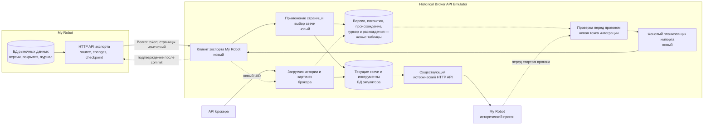
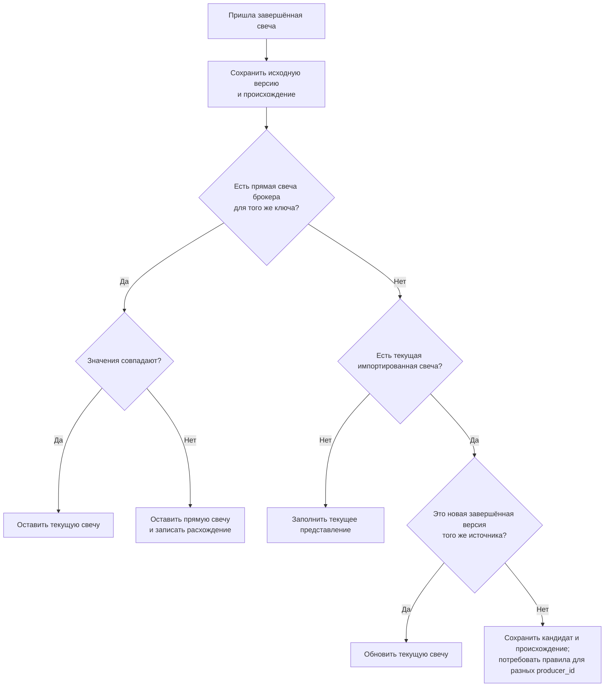
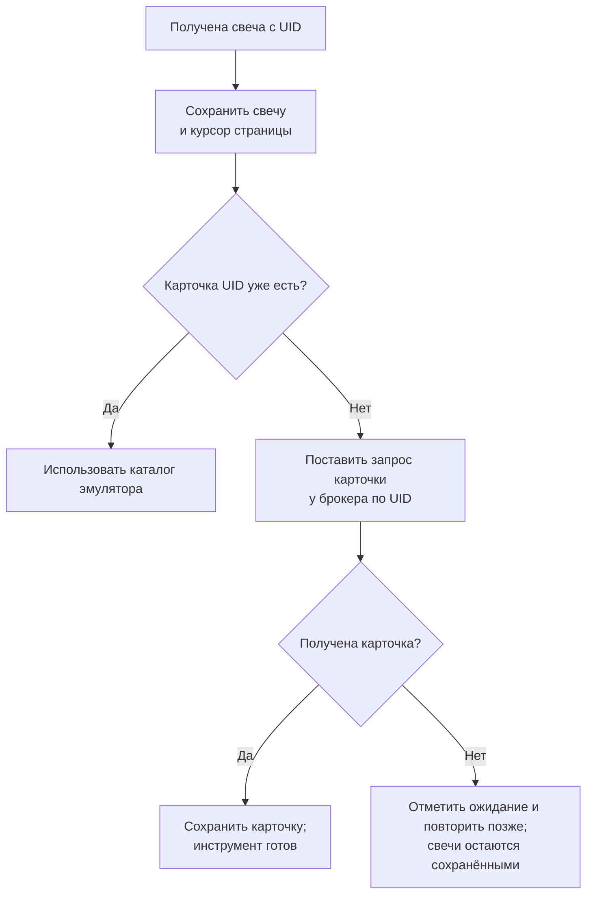
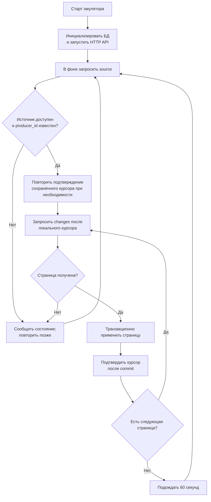
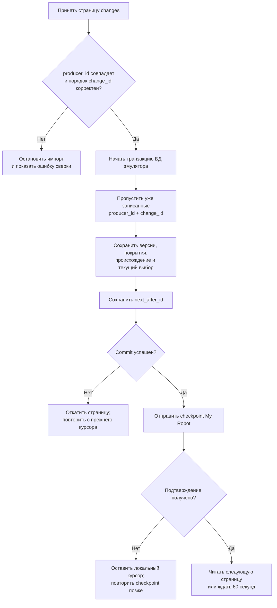
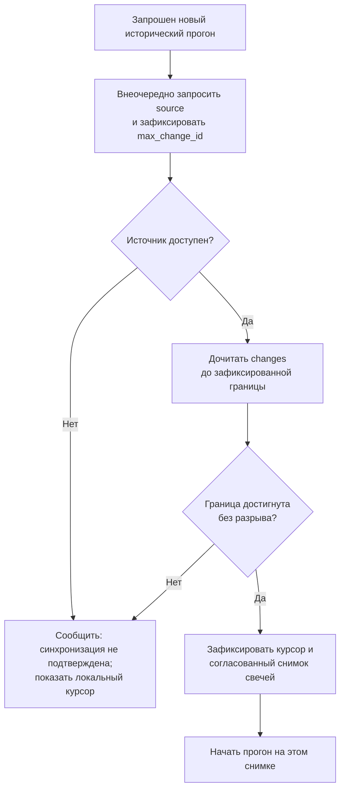

# Импорт рыночных данных из My Robot в исторический эмулятор

Статус: реализовано в эмуляторе; запуск проверки и передача номера снимка из
My Robot в его исторический клиент требуют отдельной интеграции. Подготовлен
[патч для My Robot](my-robot-preflight-integration.patch), но он не применён
в соседнем репозитории.

Этот документ фиксирует, как Historical Broker API Emulator получает изменения из
локального рыночного журнала My Robot. Контракт источника описан в
[инструкции подключения](../../My_roBot/docs/market-data/emulator-integration.md)
и [OpenAPI](../../My_roBot/docs/market-data/openapi.yaml). При расхождении деталей
формата с этим документом перед реализацией сверяемся с действующим API My Robot.

## Назначение и границы

My Robot получает текущие свечи напрямую от брокера, сохраняет завершённые
версии и состояния интервалов в своей БД и публикует журнал изменений по HTTP.
Эмулятор забирает эти изменения в собственную БД. Он также самостоятельно
скачивает исторические периоды у брокера, в том числе периоды, когда робот не
работал. Общий файл SQLite между приложениями не используется.

**Обычный исторический API эмулятора** отдаёт одну актуальную свечу на
публичную пару type+ticker, интервал и время из БД эмулятора. Импорт не меняет
формат ресурсов `/api/v1/instruments/{instrument_type}/{ticker}/candles`,
батча или coverage. Архив версий и происхождения нужен эмулятору для выбора
этой свечи, диагностики и будущего воспроизведения данных, которые видел робот;
такой режим воспроизведения не становится режимом по умолчанию.

## Архитектурные компоненты

Сплошные стрелки показывают поток данных, пунктирные — управление и запросы.
Пометки «новый» в схеме отличают компоненты этой интеграции от прежнего API.

| Компонент | Ответственность |
| --- | --- |
| Фоновый планировщик | Запускает импорт при старте, после простоя и перед прогоном; не задерживает запуск HTTP API. |
| Клиент экспорта | Работает с `source`, `changes` и `checkpoint`, токеном, таймаутами и ошибками сети. |
| Применение страниц | Проверяет порядок и идентичность источника, долговечно пишет страницу и курсор одной транзакцией, затем выбирает текущую свечу. |
| Архив импорта | Хранит все полученные версии, статусы интервалов, происхождение, расхождения и прогресс каждого `producer_id`. |
| Текущее хранилище | Содержит одну свечу, которую отдаёт существующий исторический API. |
| Загрузчик брокера | Продолжает пополнять историю и получает карточки неизвестных инструментов по UID. |

## Что переносится и как хранится

Эмулятор читает два вида событий действующего контракта: `candle_upsert` для
**завершённой** свечи и `interval_status` для состояния интервала. Ключ версии
свечи включает `producer_id`, брокерский `source`, `instrument_uid`, `interval`,
`open_time_utc` и `revision`. Каждое событие идентифицируется парой
`(producer_id, change_id)`; этот ключ уникален и защищает от повторной записи.
Цены из экспорта сохраняются в архиве в полученном десятичном представлении,
время открытия и получения — в UTC. Преобразование для существующего API
происходит отдельно и не стирает исходную версию.

Событие `interval_status` сохраняется как состояние покрытия. `pending` и
`unresolved` обозначают неопределённость; они не создают OHLCV-свечу.
`scheduled_closed` и `confirmed_no_trade` также не создают искусственную
свечу. Подтверждение страницы означает лишь, что эмулятор сохранил события;
оно не доказывает полноту рыночной истории. Нынешний вложенный ресурс coverage
показывает фактические границы и число свечей, поэтому его результат нельзя
приравнивать к доказанному отсутствию дыр.

Основная таблица свечей остаётся представлением для обычного исторического
API. В неё попадает импортированный `source=tbank_exchange`; события других
источников сохраняются в архиве без неявного смешивания типов свечей. При
миграции уже лежащие в основной таблице свечи считаются результатом прямой
загрузки брокера; переход не удаляет их. Для новых записей происхождение
хранится явно. Архив импортированных версий и покрытий не зависит от
основного представления и не теряется при замене выбранной текущей свечи.

### Выбор текущей свечи и расхождения

Прямая загрузка эмулятора у брокера имеет приоритет в обычном историческом
API. Свеча My Robot заполняет отсутствующее место. Если место заполнено
импортированной свечой, её последующая завершённая версия обновляет текущее
представление. Когда прямой ответ брокера и импорт отличаются, обе версии
сохраняются с происхождением, расхождение становится видимым для диагностики,
а обычный API отдаёт прямую свечу брокера. Одинаковые значения не создают
новой текущей записи. Решение не зависит от порядка прихода двух источников.

При новом `producer_id` старые и новые версии не объединяются по догадке:
смена локальной БД My Robot требует сверки источника. Прямую свечу брокера,
поступившую после импортированной, выбирают по тому же правилу приоритета;
исходная импортированная версия остаётся в архиве.

## Карточки инструментов

Текущий экспорт My Robot не содержит карточек. В первой реализации **не
расширяем** его событием инструмента. Эмулятор получает карточку сам через
брокерский API, используя UID из свечи, и хранит её в существующем каталоге
инструментов. Для этого потребуется запрос/очередь синхронизации именно по UID:
нынешняя ручная синхронизация ориентирована на тикер и тип.

Получение карточки не задерживает запись свечи, импортного курсора и
подтверждение страницы. Если брокер или `TINKOFF_TOKEN` недоступны, свеча
остаётся сохранённой, а карточка — в состоянии ожидания с повторной попыткой.
Пока нужных метаданных нет, нельзя выдавать инструмент за полностью готовый к
историческому прогону: существующие операции поиска и расчёта контракта
должны вернуть понятную причину неполноты. Передачу карточек от My Robot можно
рассмотреть позднее, если автономная работа без доступа эмулятора к брокеру
станет требованием.

## Когда выполняется импорт

После инициализации БД эмулятор сразу запускает фоновый импорт. Запуск HTTP
API не ждёт завершения догоняющей синхронизации. Сначала клиент получает
`producer_id`, `min_after_id` и `max_change_id`, затем продолжает с
**локально сохранённого** курсора этого производителя. Новый потребитель
начинает с `min_after_id`; если он больше нуля, ранние события недоступны и
это отмечается как неполный импорт, а не как полная история.

Пока `has_more=true`, следующая страница читается сразу. После пустой страницы
или `has_more=false` эмулятор ждёт **60 секунд** и проверяет источник снова.
Период настраивается. Если My Robot был выключен или эмулятор не работал,
следующее успешное соединение продолжает с сохранённого `change_id`. Сетевая
ошибка вызывает ограниченные повторные попытки; курсор от ошибки не
сдвигается. Новые данные извлекаются по `change_id`, поэтому увеличение БД
робота не заставляет каждый раз перечитывать старые свечи.

### Применение страницы и восстановление после сбоя

В одной транзакции эмулятора записываются все события страницы, выбранные
текущие свечи, состояния покрытия, расхождения и `next_after_id`. Сетевых
вызовов внутри транзакции нет. После commit отправляется
`PUT /api/v1/market-data/consumers/{consumer_id}/checkpoint` с тем же
`producer_id` и курсором. Если commit прошёл, а подтверждение не дошло, при
следующем соединении эмулятор повторяет подтверждение уже сохранённого
курсора. Повторная страница безопасна благодаря `(producer_id, change_id)`.

| Ответ источника | Поведение эмулятора |
| --- | --- |
| Сеть недоступна или сервер выключен | Сохранить курсор и повторить позже; работа существующего исторического API продолжается. |
| `401` | Показать ошибку экспортного токена и не продвигать курсор. |
| `409 PRODUCER_MISMATCH` | Остановить автоматическое продолжение старого курсора; зарегистрировать смену источника и потребовать сверку архива. |
| `410 CURSOR_EXPIRED` | Остановить импорт и отметить разрыв. Независимая загрузка брокера может восстановить свечи, но не утраченные версии и факт того, что видел робот; разрыв происхождения нельзя скрывать. |
| Неизвестный вид события или несовместимая версия схемы | Не подтверждать страницу до обновления потребителя. |

## Проверка перед историческим прогоном

Перед **каждым новым** прогоном выполняется внеочередная синхронизация, не
дожидаясь очередных 60 секунд. Эмулятор читает `max_change_id` у My Robot на
момент проверки, догоняет журнал как минимум до этой границы и фиксирует
достигнутый курсор вместе с результатом проверки. Если источник недоступен или
есть разрыв журнала, состояние показывается явно; прогон нельзя помечать как
синхронизированный с My Robot. При этом независимая историческая БД остаётся
доступной.

Фоновый импорт может продолжаться во время работы приложения. `POST
/api/v1/market-import/sync` возвращает `snapshot_generation` после достижения
границы журнала. Исторический клиент передаёт этот номер в запросах свечей и
покрытия на протяжении прогона: эмулятор читает историю выбранных свечей на
момент снимка. My Robot пока не вызывает эту проверку автоматически и не
передаёт номер снимка; до его доработки обычные запросы продолжают читать
актуальное состояние БД.

## Расписания торгов

My Robot публикует наблюдения расписания отдельной лентой
`GET /api/v1/market-data/trading-schedules?producer_id=&after_id=&limit=` с
собственным курсором `schedule_change_id` и подтверждением
`PUT /api/v1/market-data/consumers/{consumer_id}/trading-schedules-checkpoint`.
Поток `/changes` и его виды не меняются. Лента содержит два вида записей:

| Вид | Содержание | Таблица эмулятора |
|---|---|---|
| `schedule_day` | режим торгов, торговая дата МСК, версия, канонический `raw_json` TradingDay, `is_trading_day`, время наблюдения | `imported_schedule_days` |
| `schedule_binding` | UID → режим торгов | `imported_schedule_bindings` |

Граница ленты в `GET /source` не публикуется, поэтому синхронизация читает её
до `has_more=false` и подтверждает каждую непустую страницу. Страница
применяется атомарно. Версия дня обязана совпадать с sha256 `raw_json`, иначе
страница отвергается и лента получает состояние `blocked`. Версии не
затираются: новая версия дня — новая строка. Ответ 404 означает робота без
ленты: состояние `unsupported`, свечной импорт продолжается. Сбой ленты
расписаний не меняет состояние свечного источника.

### Общий счётчик поколений

`snapshot_generation` — значение таблицы `snapshot_generation`. Номер из
этого счётчика получает каждая версия свечи (триггеры `candles`) и каждая
применённая страница расписаний. Чтение с номером N видит только строки с
поколением не больше N, поэтому снимок, выданный `POST /sync` после обеих лент,
не меняется ни от новых свечей, ни от новых версий расписания.

### Выдача роботу

`GET /api/v1/trading-schedules?instrument_id=&from=&to=[&snapshot_generation=]`
определяет режим торгов по последней видимой привязке UID и для каждой
торговой даты МСК диапазона отдаёт последнюю видимую версию дня. `day` — это
разобранный `raw_json` без изменений: робот пересчитывает версию и сверяет её.
Даты без дня попадают в `missing_dates`. Без привязки `exchange` равен `null`,
`days` пуст. Неизвестный UID — 404, номер снимка больше текущего — 400
`INVALID_SNAPSHOT`. Дни с `source=emulator` и `source=emulator-reconstructed`
(ответ эмулятора, записанный роботом) обратно не раздаются.

Брокер не отдаёт расписание прошедших дат. Для них эмулятор хранит дни,
восстановленные командой `reconstruct-schedules` по файлу правил
(`config/schedule_rules/<режим>.toml`), в отдельных таблицах
`reconstructed_schedule_days` и `reconstructed_schedule_bindings`. Строки не
перезаписываются: каждый запуск добавляет новые версии в одном новом поколении
общего счётчика, поэтому снимок, выданный до генерации, восстановленных дней не
видит. Для каждой даты отдаётся видимый в поколении день из ленты, а если его
нет — восстановленный (`provenance: reconstructed`, `rules_version`,
`source: emulator-reconstructed`); привязка выбирается с тем же приоритетом
(`binding_provenance`). В `missing_dates` остаются только даты без того и
другого. Генератор не создаёт день там, где уже есть день из ленты, и привязку
UID, у которого есть импортированная. Восстановленный день — канонический
TradingDay той же формы, что у брокера: эталонный тест сверяет версии дней
2026-10-13 — 2026-10-23 с записанными роботом.

## Миграция и наблюдаемость

Существующие свечи и карточки эмулятора сохраняются. Новые таблицы и признаки
происхождения добавляются миграцией на месте с резервной копией и проверкой
версии схемы. Прежнее объяснение «историческая БД — только заменяемый кэш»
после появления импортных версий неприменимо: удаление БД может уничтожить
неповторимый архив того, что видел My Robot. Команда полного сброса должна
явно предупреждать об этом.

Настройки импорта: включение, адрес экспорта My Robot, отдельный Bearer-токен,
стабильный `consumer_id`, период проверки (по умолчанию 60 секунд) и таймауты.
Токен не записывается в БД и логи. Для соединения между разными машинами
нужен TLS на внешней границе. Оператору видны `producer_id`, локальный курсор,
последнее подтверждение, отставание от `max_change_id`, время успешной
синхронизации, число расхождений, незаполненные карточки и разрывы импорта.

В эмуляторе реализованы клиент экспорта, архив, выбор текущей свечи, импорт
расписаний, фоновый планировщик и API внеочередной проверки. Для полноценного запуска из My Robot
осталось вызвать эту проверку перед прогоном и передать полученный
`snapshot_generation` в исторические запросы.
